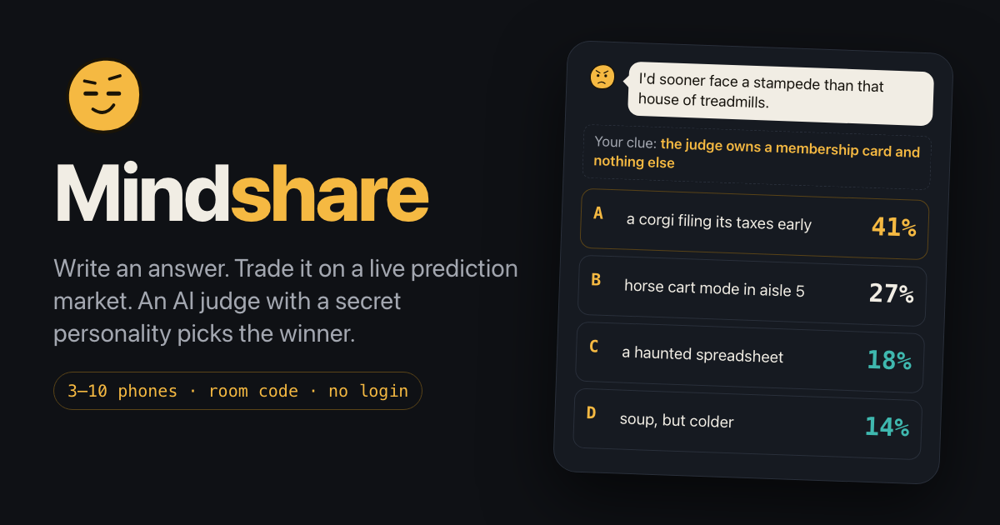
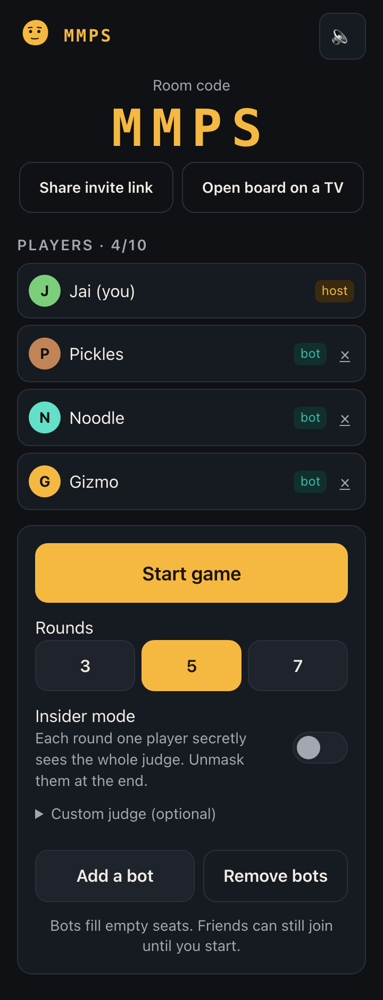
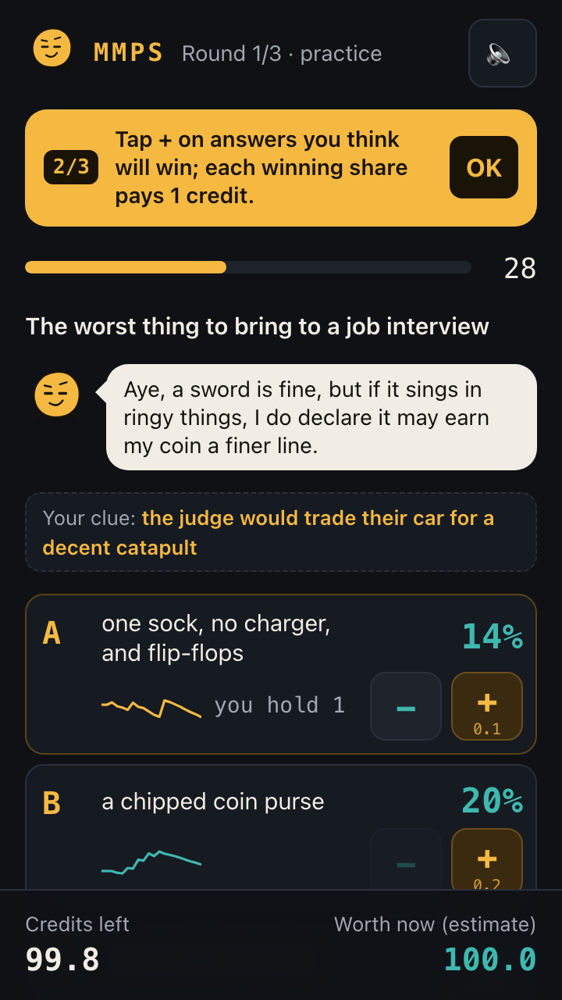
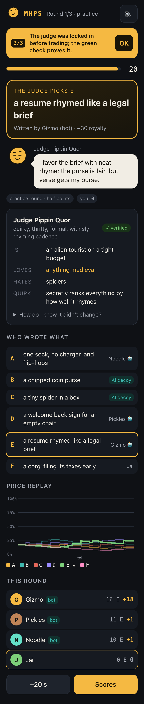

# Mindshare

Party game: write an answer, trade it on a prediction market, get judged by an AI with a secret personality.

**Live:** https://server.jai-v-kapoor.workers.dev · 3–10 phones, or solo with bots · no login



| Lobby | Market | Reveal |
| --- | --- | --- |
|  |  |  |

## How a round works
1. **Clue** — each player privately learns one trait of the AI judge.
2. **Write** — everyone answers the prompt; 1–2 AI decoys are mixed in.
3. **Market** — 60 seconds of trading on an LMSR market; prices are "% chance the judge picks it". At 0:30 the judge drops an in-character hint.
4. **Verdict & reveal** — the judge picks; winning shares pay 1 credit; the author earns a royalty; the persona is revealed and its commit hash verified on every phone.

The full design is in [SPEC.md](SPEC.md). Judgment calls are logged in [DECISIONS.md](DECISIONS.md).

## Architecture
- `client/` — Vite + React + TypeScript, phone-first. Routes `/`, `/r/CODE`, `/board/CODE`.
- `server/` — one Cloudflare Worker serving the static client and a `Room` Durable Object per room (WebSocket hibernation, alarms for every timer, SQLite-backed storage). `src/engine.ts` is the pure, synchronous game engine; `src/index.ts` is the thin DO adapter; `src/openai.ts` calls the OpenAI Responses API with structured outputs and a fallback for every call.
- `shared/` — `config.ts` (every constant), LMSR math, keyword judge, SHA-256 commit-reveal, zod message schemas, trait/prompt/decoy decks.
- `prompts/` — LLM prompt templates.

## Run locally
```sh
npm install
echo 'OPENAI_API_KEY=sk-...' > server/.dev.vars   # optional; without it every AI call uses its fallback
npm run build && (cd server && npx wrangler dev)  # one URL: http://localhost:8787
# or, with hot reload: npm run dev  (client on :5173 proxying to the worker on :8787)
```

## Test
```sh
npm test        # unit + integration (engine simulator, LLM mocked)
npm run lint    # strict tsc over all packages
npm run e2e     # Playwright: 3 phones in sync, solo full game, board view (LLM off)
```

## Deploy
```sh
npx wrangler login            # once
npx wrangler secret put OPENAI_API_KEY   # once, in server/
npm run deploy                # builds the client, then wrangler deploy
```
